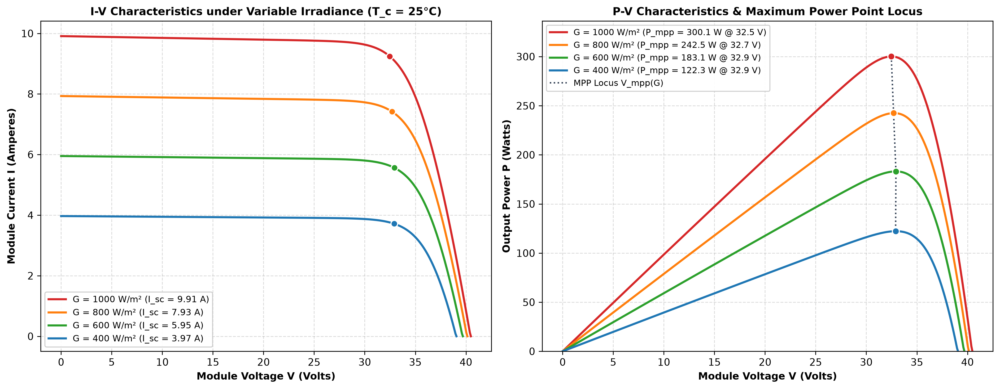
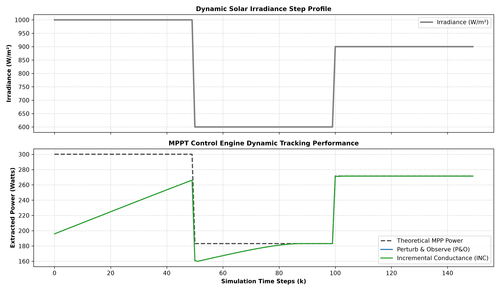
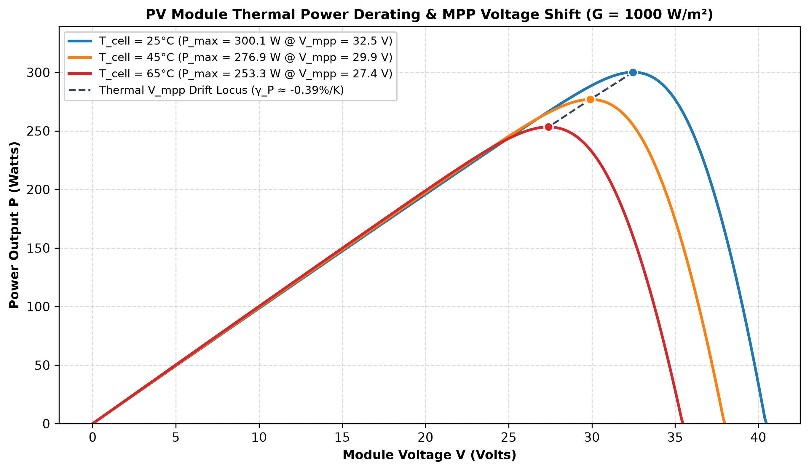
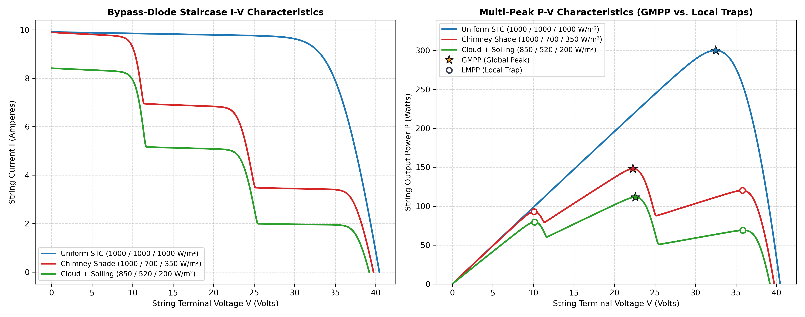
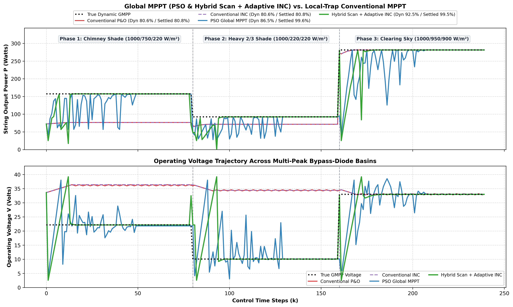
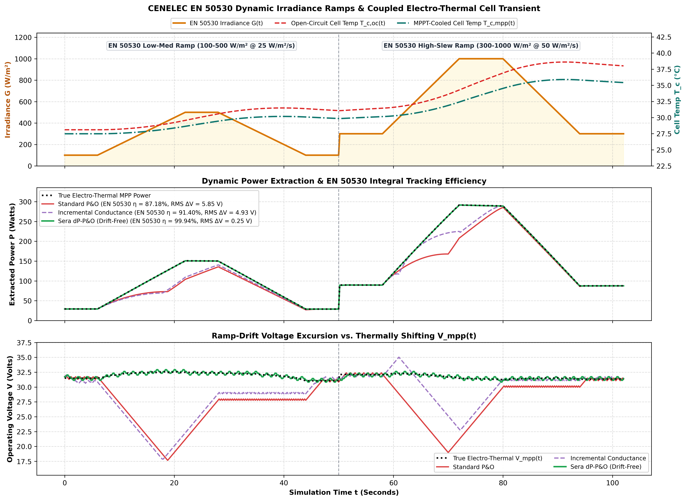
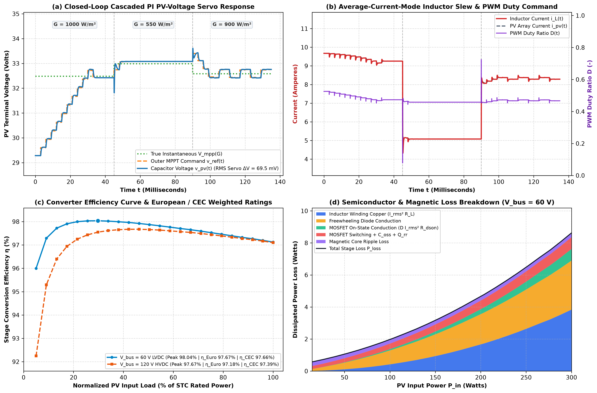

# Solar PV Dynamic Characterization, Global MPPT & Boost Stage Solver

[](https://github.com/hariszafar740-lang/solar-pv-mppt-dynamic-solver/actions/workflows/ci.yml)
[](https://hariszafar740-lang.github.io/solar-pv-mppt-dynamic-solver/)
[](https://hariszafar740-lang.github.io/solar-pv-mppt-dynamic-solver/)

[](https://github.com/hariszafar740-lang/solar-pv-mppt-dynamic-solver/releases/tag/v1.0.0)
[](LICENSE)

Multi-physics Python package (`pv-mppt-solver`), command-line suite (`pv-mppt`).
And **[Live Interactive GitHub Pages Workbench](https://hariszafar740-lang.github.io/solar-pv-mppt-dynamic-solver/)** coupling **CEC/pvlib-verified Single-Diode PV Physics, Schottky Bypass-Diode Partial Shading.
Global MPPT (PSO & Hybrid Global-Scan + Adaptive INC), CENELEC EN 50530 Dynamic Irradiance Ramps with Coupled Electro-Thermal Cell ODE & Sera `dP-P&O`.
And a State-Space Averaged DC-DC Boost Power Stage with 2-Loop Cascaded Current-Mode PI Control**.

## Subsystem Verification Summary

| Subsystem | Module | Key Verified Metric |
|---|---|---|
| Single-Diode CEC Extraction | `src/pv_model.py` | `300.1152 W` STC (`< 1e-8 A` vs. `pvlib` Lambert-W across `-10..75 °C`) |
| Schottky Bypass Partial Shading | `src/partial_shading.py` | Exact KVL multi-peak staircases (`148.16 W @ 22.28 V`, 3 peaks under `1000/700/350 W/m²`) |
| Global MPPT (PSO & Hybrid INC) | `src/global_mppt.py` | `92.47%` Hybrid dynamic / `99.57%` PSO settled vs. `80.60%` conventional LMPP trap |
| CENELEC EN 50530 & Thermal ODE | `src/en50530_benchmark.py` | `99.94%` Sera `dP-P&O` (`0.25 V` RMS error) vs. `87.18%` Standard P&O ramp drift |
| State-Space Boost & Cascaded PI | `src/dynamic_boost.py` | `η_Euro = 97.67%` (`60 V` LVDC), `69.5 mV` RMS voltage-servo tracking error |
| CLI & Interactive Web Explorer | `src/cli.py`, `src/web_dashboard.py` | `pv-mppt` (`info`, `iv`, `shading`, `en50530`, `boost`, `benchmark`, `web`) + real-time browser lab |

## Mathematical System Formulation

### 1. Single-Diode Cell Equation

~~~
I = I_ph - I_0 [ exp( (V + I R_s)/(n N_s k T / q) ) - 1 ] - (V + I R_s)/(R_sh(G))
~~~

solved for I at every grid voltage with a vectorized, monotone-convergent Newton iteration (bisection fallback).

### 2. Self-Consistent Reference-Parameter Extraction

The diode parameters (I_(ph,ref), I_(0,ref), n) are **not** hand-picked.
At construction time the solver exactly satisfies the three STC datasheet constraints

~~~
I(V=0) = I_sc, I(V=V_oc) = 0, I(V=V_mp) = I_mp
~~~

For fixed n, the first two constraints are linear in (I_(ph,ref), I_(0,ref)); the third is a scalar root-find in n (bracketed bisection). If the datasheet values are inconsistent with the single-diode model for any physical ideality factor (0.5 ≤n ≤2.5), the constructor raises `ValueError` rather than silently under-predicting STC power.

### 3. Temperature / Irradiance Scaling (De Soto / CEC convention)

~~~
I_ph(G,T) = (I_(ph,ref) + K_i (T - T_ref))G/G_ref, 
I_0(T) = I_(0,ref)(T/T_ref)^3 exp((E_(g,ref))/(k_eV T_ref) - (E_g(T))/(k_eV T))
~~~

~~~
E_g(T) = 1.121eV·(1 - 2.677×10^(-4)(T - T_ref)), 
R_sh(G) = R_(sh,ref)G_ref/G
~~~

### 4. Boost Converter Duty Cycle Translation

To match the dynamic PV array MPPT voltage V(mpp) to a fixed DC link voltage V(out):

~~~
D = 1 - V_mpp/V_out
~~~

### 5. Series-String Bypass-Diode Partial Shading

For a series string of M = N(mod) ×N(bp) cell substrings under non-uniform irradiance G(m) and cell temperature T(m).
Kirchhoff's Voltage Law gives V(string)(I) = Σ_(m=1)^M V(m)(I), where each substring is protected by an anti-parallel Schottky bypass diode conducting in reverse bias (V(m) < 0):

~~~
I_(sub,m)(V_m) = I_(cell,m)(V_m) + I_(0,bp)[exp(-V_m / V_(t,bp)) - 1], for V_m < 0;
0, for V_m ≥0
~~~

### 6. Global MPPT Under Multi-Peak Partial Shading

Conventional hill-climbing trackers (`PerturbAndObserve`, `IncrementalConductance`) follow local dP/dV sign and become trapped in high-voltage local maxima (LMPPs). `src/global_mppt.py` provides two Global MPPT (GMPPT) engines with zero steady-state oscillation lock and bypassed-plateau cloud-clearance watchdog probing:

* `ParticleSwarmMPPT`: Stratified N(p)-particle voltage swarm with annealed inertia w(k): w(max) →w(min), velocity clamping, convergence lock, and event-triggered re-dispersion.
* `HybridGlobalScanINC`: Fast coarse global voltage sweep across [V(min), V(max)] followed by Variable-Step Adaptive Incremental Conductance (ΔV(k) = clip(α |dP/dV|, ΔV(min), ΔV(max))).

### 7. CENELEC EN 50530 Dynamic Ramp Standard & Coupled Electro-Thermal Cell Transient

`src/en50530_benchmark.py` evaluates dynamic MPPT efficiency η_(MPPT,dyn) = ∫_0^T P(DC)(t)dt / ∫_0^T P(MPP)(G(t).
T(c)(t))dt across standardized trapezoidal irradiance ramps (100--500W/m^2 and 300--1000W/m^2) coupled with a first-order lumped module energy-balance ODE:

~~~
C_th dT_c/dt = α_abs G(t) - P_elec(t)/A_mod - U_th(T_c(t) - T_amb)
~~~

Includes Sera's irradiance-compensated **`DeltaPPO`** (`dP-P&O`) controller, eliminating ramp-induced voltage drift (`99.94%` EN 50530 efficiency vs. `87.18%` for standard P&O).

### 8. State-Space Averaged Boost Power Stage, Cascaded Current-Mode PI Control & Loss Map

`src/dynamic_boost.py` upgrades the steady-state duty translator to a coupled 2nd-order `[v_pv, i_L]` non-ideal boost stage integrated via 4th-order Runge-Kutta with discontinuous-conduction diode blocking (`i_L >= 0`):

~~~
C_in dv_pv/dt = i_pv(v_pv, G, T_c) - i_L, L di_L/dt = v_pv - R_eq(D) i_L - (1 - D)(V_bus + V_fd)
~~~

* `CascadedBoostPIController`: Decouples the lightly damped input L--C(in) tank into an outer PV-voltage PI loop commanding i_(L,ref) (with i(pv) feedforward) and an inner average-current-mode PI loop commanding PWM duty D (`69.5 mV` RMS voltage-servo error across `1000 -> 550 -> 900 W/m²` irradiance steps).
* `BoostLossBreakdown` & Weighted Efficiencies: Resolves inductor winding copper (I(rms)^2 R(L)), MOSFET conduction (D I(rms)^2 R_(ds(on))), switching + C(oss) + reverse-recovery Q(rr).
* Freewheeling diode conduction, and magnetic core ripple losses, alongside European (η(Euro) = 97.67%) and California CEC (η(CEC) = 97.66%) weighted ratings at V(bus) = 60V.

## Reference Module & Data Provenance

Default constructor parameters are the STC datasheet values of the **AU Optronics PM060MBR_300W** monocrystalline 60-cell module, taken verbatim from the NREL SAM / CEC module database.
Record version "SAM 2018.11.11 r2" (dated 2019-01-03), as bundled with pvlib 0.16.1 (`sam-library-cec-modules-2019-03-05.csv`, SHA-256 `a7c3b1ad3dabb5425368615c16322f2e35185fc416380b471c4e48dd545b1920`).

| Quantity | Value | Source |
|---|---|---|
| `I_sc_ref` | 9.91 A | record datasheet value (model input) |
| `V_oc_ref` | 40.45 V | record datasheet value (model input) |
| `I_mp_ref` | 9.24 A | record datasheet value (model input) |
| `V_mp_ref` | 32.48 V | record datasheet value (model input) |
| `R_s` | 0.358977 Ω | record CEC fit (model input) |
| `R_sh_ref` | 171.705124 Ω | record CEC fit (model input) |
| `alpha_sc` | 0.004162 A/K | record (model input, `K_i`) |
| `STC` | 300.1152 W | record rating, *verification target only* |
| `a_ref` | 1.550532 V | record CEC fit, *verification target only* |
| `I_L_ref` / `I_o_ref` | 9.930718 A / 4.536912e-11 A | record CEC fit, *verification targets only* |

Independent verification (see `tests/test_reference_cec.py` and `tests/test_pvlib_crosscheck.py`):

* Extraction from the datasheet values alone reproduces the record's own CEC-fitted diode parameters: `a = 1.55053183 V` vs `a_ref = 1.550532`, `I_ph_ref = 9.93071844 A` vs `I_L_ref = 9.930718`, `I_o_ref = 4.5369e-11 A` vs `4.536912e-11`.
* Model STC maximum power = 300.1152 W, matching the record's `STC` field and pvlib's own `singlediode` result (300.1151 W) to solver precision.
* Full I-V curves agree with pvlib's Lambert-W evaluation (`i_from_v`) to < 1e-8 A across 9 (G, T) conditions from −10 °C to 75 °C and 50–1100 W/m².
* Implied temperature coefficients are physical and close to the record's: β_voc ≈ −0.125 V/K (record −0.114069), γ_p ≈ −0.391 %/K (record −0.386).

> Provenance disclaimer. The identity of the module that the *original* hard-coded defaults
> (I(sc)=9.35, V(oc)=38.2, I(mp)=8.80, V(mp)=34.1, R(s)=0.221, R(sh)=415.6, n=1.3) were meant to
> represent could not be established: no CEC/SAM record matches them, and they are mutually
> inconsistent with the single-diode model, reproducing their nameplate 300.08 W would require a
> non-physical ideality factor (n ≈ 0.47). The old implementation silently ignored I(mp)/V(mp) and
> produced 266.898 W at STC. The constructor now rejects such inconsistent sets with a
> `ValueError` (regression-tested). The AU Optronics record above is a **pinned, traceable
> replacement reference**, not a claim that it was the original panel.

## Validity Envelope

* Irradiance: finite, real, `G >= 0` W/m² (`G < 0` raises `ValueError`; `G = 0` returns zero generation on a well-formed grid).
* Cell temperature: finite, real, −40 °C ≤ T ≤ +85 °C (standard c-Si module operating envelope).
* All outputs are real, finite `float64`; current is reported in the generating quadrant (clamped at 0 beyond V(oc)).
* Known simplifications vs.
* SAM/pvlib: CEC `Adjust` factor taken as 0; `R_s` temperature independent; ideality factor constant with temperature.
* The model is an engineering-grade single-diode solver, not a manufacturer-level performance prediction tool.

## Installation & Engineering CLI (`pv-mppt`)

```bash
python3 -m venv .venv
source .venv/bin/activate # Windows: .venv\Scripts\activate
python -m pip install --upgrade pip setuptools wheel
pip install -r requirements.txt -r requirements-dev.txt
pip install --no-build-isolation -e .

# optional: independent pvlib 0.16.1 CEC cross-validation (Python >= 3.11)
pip install -r requirements-validation.txt

# Inspect CEC reference module & single-diode extraction
pv-mppt info

# Solve operating point, partial shading, EN 50530 ramps & boost stage (ASCII or --json)
pv-mppt iv --irradiance 850 --temp 40 pv-mppt shading --irradiances 1000 700 350 --run-gmppt pv-mppt en50530 --json pv-mppt boost --v-bus 60 --stages 1000:45 550:45 900:45

# Run full test suite & regenerate all 7 publication figures
python -m pytest pv-mppt benchmark --output-dir results pv-mppt web --output-dir site # build interactive HTML5/Canvas workbench
```

## Simulation Artifacts & Dynamic Results
### STC PV Characteristic Curves


### Dynamic MPPT Step Response


### Thermal Power Derating


### Bypass-Diode Partial-Shading & Multi-Peak P-V Curves


### Global MPPT (PSO & Hybrid Scan + Adaptive INC) vs. Local-Trap Conventional MPPT


### CENELEC EN 50530 Dynamic Irradiance Ramps & Coupled Electro-Thermal Cell Transient


### State-Space Averaged Boost Stage, Cascaded PI Servo & Loss Breakdown


## Testing & CI

* `pytest` suite (230 tests) covers the STC reference point.
* The historical 300.08 W / 266.898 W defect, invalid-input rejection (negative/NaN/complex irradiance, out-of-envelope temperature), zero & low irradiance.
* Thermal derating, MPPT convergence/steady-state stability/dynamic step response/voltage bounds, boost-converter math & clamping, and the pinned CEC reference data.
* pvlib cross-checks (`tests/test_pvlib_crosscheck.py`) run automatically when pvlib is installed and skip otherwise.
* The core suite is hermetic and needs no network access.
* GitHub Actions (`.github/workflows/ci.yml`) installs `pv-mppt-solver` in editable mode and runs `ruff`, `pytest`, `pv-mppt` CLI smoke tests.
* And `main.py` across Python 3.10–3.13 (pvlib cross-checks on 3.11/3.12).

## Citation

Machine-readable citation metadata (`v1.0.0`) is provided in [`CITATION.cff`](CITATION.cff) (GitHub's *"Cite this repository"* button exports APA and BibTeX directly).
